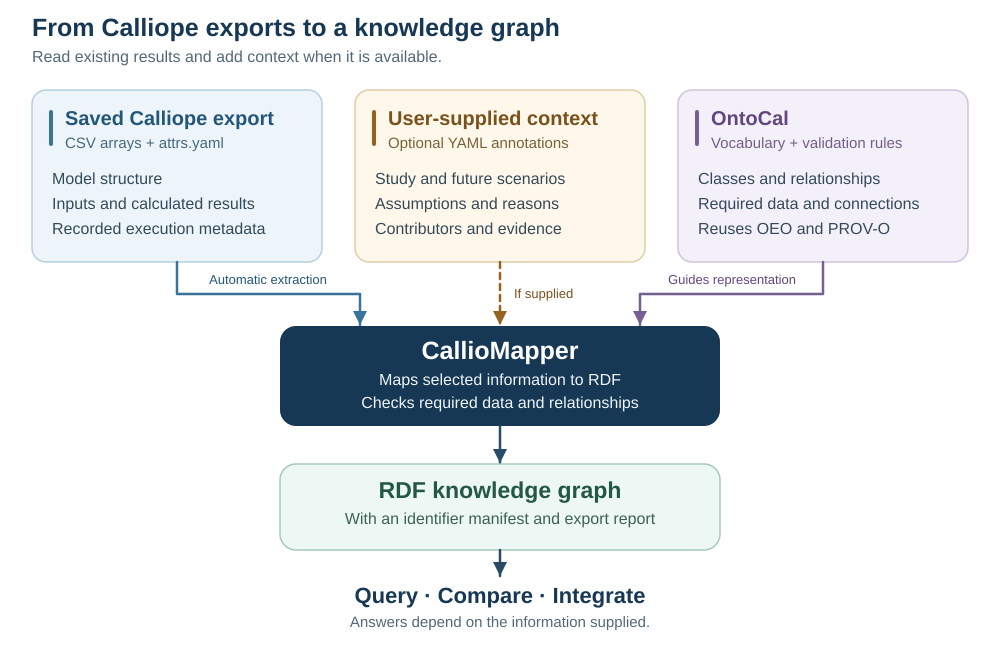

# CallioMapper

CallioMapper turns selected information from a saved Calliope modelling exercise into an RDF knowledge graph. Researchers can query model structure, inputs and results alongside the configurations, executions and source files they belong to. They can also supply context that the numerical files do not contain, such as a study question, the meaning of a future scenario or the reason for a parameter choice.

The representation uses **OntoCal**, with the unchanged Open Energy Ontology (OEO) 2.12.0 distribution and its foundational definitions. This version does not import PROV-O. Model components are represented as information about an energy system. A component is connected to a physical asset only when an explicit, evidenced correspondence is supplied.

**Version `0.1.0rc3` is a local candidate for internal research trials.** It adopts the OEO-based OntoCal representation and annotation schema 2. This update has not been published as a new release. The primary target is saved CSV exports from stable **Calliope 0.7.0**. The included national and urban examples provide tested cases; they do not establish compatibility with every Calliope feature or custom mathematical model. Historical **0.7.0.dev7** examples remain covered by regression tests. Other Calliope formats, NetCDF, unsolved models and failed-run exports are not supported by this reader. See the [evaluation and its limits](docs/evaluation.md) and [change history](CHANGELOG.md).



## Install locally

Use Python 3.10 or later. The [evaluation record](docs/evaluation.md) identifies the environments tested for each candidate. From a cloned or downloaded copy of this repository:

```sh
python -m venv .venv
source .venv/bin/activate
python -m pip install .
```

Alternatively, install a locally supplied release-candidate wheel:

```sh
python -m pip install /path/to/calliomapper-0.1.0rc3-py3-none-any.whl
```

The examples and notebooks below are repository files, so run them from the repository directory even when the package was installed from a wheel. These instructions do not require a PyPI release. On Windows, activate the virtual environment using its `Scripts` directory instead.

CallioMapper does not require Calliope, a solver, Java or ROBOT for ordinary use. It reads files that already exist; it does not rebuild or solve the model.

## Try it in Python

The saved national example can be translated and queried without an optimisation run:

```python
from calliomapper import Translator
from calliomapper.queries import run_query

translator = Translator(
    "examples/calliope-0.7.0-glpk/national_scale/results_directory"
)
translator.save("build/national.nq")
dataset = translator.translate()  # Returns the graph already created by save().

answers = run_query(
    dataset, "installed_capacity", bindings={"technology": "ccgt"}
)
columns = ("node", "technology", "carrier", "value", "unit")
rows = [
    {column: str(answer[column]) if answer[column] is not None else None
     for column in columns}
    for answer in answers
]
print(rows)
```

The returned row describes the capacity in the saved result:

| node | technology | carrier | value | unit |
|---|---|---|---|---|
| region1 | ccgt | power | 30000.0 | `None` |

`None` means that this export has not supplied a concrete unit interpretation; it does not mean the value is dimensionless. Removing the technology filter returns fifteen capacity records. `run_query()` returns an RDFLib query result; the example converts selected columns to ordinary Python dictionaries and needs no pandas dependency.

The save operation writes three files:

- **`national.nq`** contains the graph in N-Quads format, which retains separately identified graphs for source and computed statements, supplied context and export provenance.
- **`national.nq.manifest.json`** is a small companion file recording the identifier namespace, configuration and execution fingerprints, and package and ontology versions. Keeping it allows later exports to reuse identifiers for unchanged model components, configurations and executions. The RDF graph remains readable without it.
- **`national.nq.report.json`** records what was extracted, what was omitted and why, source-file checksums, available version evidence and validation results.

For a guided introduction, install the optional notebook dependencies and open JupyterLab:

```sh
python -m pip install '.[notebooks]'
jupyter lab notebooks
```

Open the notebooks in order:

1. [Read saved results and query the graph](notebooks/01_saved_results.ipynb).
2. [Supply research context and inspect what it adds](notebooks/02_supplied_context.ipynb).
3. [Compare represented results and combine separately identified graphs](notebooks/03_comparison_and_integration.ipynb).

## What is represented

The default export includes these groups. `structure` is always included; the other groups can be selected with the `groups` argument.

| Group | Information represented |
|---|---|
| `structure` | Active nodes and technology components, carriers, transmission endpoints, configuration and execution identities. |
| `capacities` | Selected effective capacity bounds and efficiencies, calculated flow capacity and storage capacity. |
| `energy` | References to saved output series and, when the saved mathematics supports the interpretation, weighted energy totals over their saved time coverage. |
| `costs` | Selected capacity-cost inputs and saved component costs, with their cost-category coordinates. |

For example, `Translator(path, groups={"structure", "capacities"})` creates a smaller graph. Complete time series remain in their source files by default. Individual timesteps can be selected explicitly, as described in the [usage guide](docs/usage.md). This release translates a stated set of variables rather than every array or equation in a model.

Missing units and currencies are not guessed. The included national example supports the documented energy calculation. The urban example contains custom mathematics, so automatic energy totals are omitted with an explanation; its series references, capacities and costs remain available. A successful export therefore does not imply that every research question can be answered.

## Add information that the saved files do not contain

An optional YAML annotation file supplies study and scenario descriptions, assumptions, reasons, dataset history and physical correspondences. It records who contributed to creating or supplied the statements, and their evidence status. A known author of a source report and responsibility for a study or preparation process can be recorded separately.

```python
translator = Translator(
    "examples/calliope-0.7.0-glpk/national_scale/results_directory",
    annotations="examples/calliope-0.7.0-glpk/annotations/national.yaml",
    identity_file="build/national.nq.manifest.json",
)
translator.save("build/national-annotated.nq")
reasons = run_query(translator.translate(), "cq05")
```

The example includes **synthetic tutorial context**, not the original model authors' study history. Its capacity-unit interpretation has separately identified evidence in the source comments. The [annotation guide](examples/annotations/README.md) describes the supported fields. The [competency-question guide](docs/questions.md) states which questions require additional information from the user.

Extracted facts, computed summaries and supplied context have different sources of evidence. Validation checks how the claims are represented; it does not establish that a supplied scientific claim is true or recover unrecorded reasoning.

## Use the command line

The same workflow is available without writing Python:

```sh
calliomapper translate examples/calliope-0.7.0-glpk/national_scale/results_directory --out build/national.nq
calliomapper query build/national.nq --preset installed_capacity --out build/capacities.csv
calliomapper init-annotations --out annotations.yaml
```

The input directory must contain `attrs.yaml` and the saved `inputs_*.csv` and `results_*.csv` files. Its name is arbitrary. Calliope writes these files through an explicit CSV save operation; simply solving a model does not create this directory automatically.

## Ontology dependencies and evidence

OntoCal is maintained separately as a Turtle ontology. The package includes a fixed snapshot and validation resources, so an OntoCal checkout is not required. Historical LinkML files under `ontocal/` are not used by this implementation.

The bundled OEO 2.12.0 publisher file is unchanged. OntoCal uses OEO for information inputs, outputs, authors and contributors, with a few local relationships for supplier information, responsibility, revision references and process times. PROV-O is not imported. The [dependency explanation](docs/dependencies.md) describes the scope and the future PROV interoperability work. Existing schema-1 annotation files require an explicit update; the [migration instructions](examples/annotations/README.md#migrating-an-annotation-file-from-version-1) explain how to preserve their meaning.

The stable examples were prepared using Calliope 0.7.0 and GLPK 5.0. GLPK was used only for that preparation; normal graph generation and tests read the saved outputs. Stable Calliope's ordinary CSV export omits the recorded initialisation-version field. Its configured target version helps identify the format but does not prove which executable produced the results. Graphs and reports preserve that uncertainty. The [example preparation record](examples/calliope-0.7.0-glpk/README.md) provides independent software-version evidence for the included examples.

- [Usage, supported variables and identifier handling](docs/usage.md)
- [Questions and required information](docs/questions.md)
- [Evaluation procedure and recorded results](docs/evaluation.md)
- [Changes in this release](CHANGELOG.md)
- [Contributing and reporting problems](CONTRIBUTING.md)
